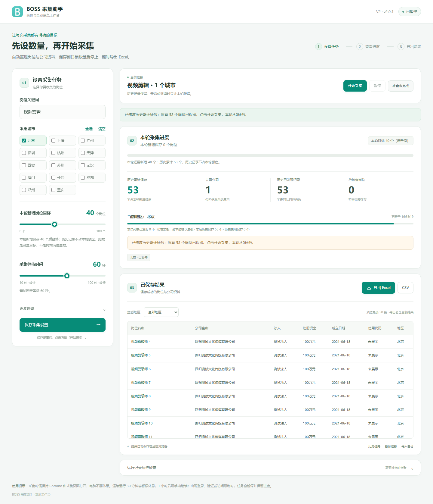

# BOSS岗位企业采集助手 V2

一个中文 Chrome 浏览器插件。填写岗位关键词、选择城市后，它会自动切换 BOSS 地区、加载岗位列表，并把岗位和对应公司的工商信息整理到表格中。

**使用顺序：下载 → 安装插件 → 登录 BOSS → 选关键词和城市 → 开始 → 导出 Excel。**

当前版本：**V2（2.0.1）**。无需影刀，也不需要安装 Python 或 Node.js 才能使用。

**[下载 V2 修复版](https://github.com/TsNIUPI/boss-job-collector/releases/download/v2.0.1/BOSS-Collector-V2-v2.0.1.zip)** · [更新说明](https://github.com/TsNIUPI/boss-job-collector/releases/tag/v2.0.1) · [简明使用说明](使用说明.md)



界面预览使用演示数据。

主设置使用两个滑轨：本轮新增岗位目标0–100个（默认50），等待时间10–100秒（默认60）。目标只统计当前一轮首次保存的新岗位；历史累计记录、重复岗位和待核查记录不占本轮额度，直接复用公司资料保存的新岗位计入。0不会启动。

例如历史累计53个、设本轮目标40个：开始时本轮新增为0，最多再新增40个，累计可达到93个。界面分别显示本轮新增、设置目标、历史累计和列表发现数；设置目标不能证明网站实际存在该数量的岗位。

普通暂停、定时休息、浏览器重启和备份恢复保留本轮计数；达到目标后点击“开始新一轮”才重新从0计数。已经检查完的城市也可再次检查新岗位。调低目标到本轮已保存数以下时准备新一轮，历史记录始终保留。

开启变化等待时，每轮等待从滑轨值至 `min(100, 2×滑轨值−1)` 秒；关闭后按滑轨值固定等待。比如60秒对应60–100秒，10秒对应10–19秒。网页加载、浏览器休眠可能延迟实际执行；它不是每条岗位的固定耗时。

## 可以做什么

| 功能 | 对你有什么用 |
| --- | --- |
| 自定义岗位关键词 | 可以把“tiktok剪辑”改成“视频剪辑”“跨境电商运营”等 |
| 多城市采集 | 支持北京、上海、广州、深圳、杭州、天津、西安、苏州、武汉、厦门、长沙、成都、郑州、重庆 |
| 自动加载岗位 | 滚动加载更多岗位，不只处理页面最初显示的15条 |
| 自动切换城市 | 当前城市确认完成后，继续下一个勾选城市 |
| 岗位与公司对应 | 同一家公司招聘多个岗位时，批量保存并共享复用公司信息，换关键词或导入备份后也可使用 |
| 进度显示 | 查看当前城市、当前岗位、已发现岗位、已保存岗位、去重公司和待核查数量 |
| 暂停与断点续跑 | 保留采集状态，继续时恢复城市和关键词，跳过已保存记录 |
| 多地区结果保留 | 同关键词调整城市时，已保存的其他地区记录仍保留 |
| 导出与备份 | 导出 Excel、CSV，或备份任务 JSON 用于恢复断点 |
| 连接恢复 | 短暂连接失败时尝试恢复采集页；重复失败会提示原因并保留断点 |

### 导出的字段

岗位名称、公司全称、法定代表人、注册资金、成立日期、统一社会信用代码、地区。

“地区”表示岗位工作城市，不一定等于公司的注册地址。公司工商信息以 BOSS 公司详情页实际展示内容为准。插件不查询电话、邮箱。

## 第一次安装：一步一步来

需要电脑上的 **Google Chrome 120或更新版本**，并且能正常访问和登录 BOSS。

1. 在本仓库页面找到绿色的 **Code** 按钮，点击 **Download ZIP**。
2. 找到下载的 ZIP，右键选择 **全部解压缩**。不要直接在压缩包里安装。
3. 把解压后的文件夹放到固定位置，例如 `D:\工具\boss-job-collector`。安装后不要随意移动或删除这个文件夹。
4. 打开 Chrome，在地址栏输入 `chrome://extensions`，按回车。
5. 打开右上角的 **开发者模式**。
6. 点击左上角 **加载已解压的扩展程序**。
7. 选择包含 `manifest.json` 的文件夹。如果你看到的只是外层文件夹，就再进入一层。
8. 出现“BOSS岗位企业采集助手”卡片，说明安装成功。
9. 点击 Chrome 右上角的拼图图标，找到插件，点击旁边的图钉固定到工具栏。
10. 点击插件图标，打开采集工作台。

> 这是通过文件夹安装的插件，目前没有发布到 Chrome 应用商店。

## 第一次采集：以北京为例

1. 在**安装了插件的同一个 Chrome 用户配置**中打开 BOSS 网站，正常登录账号。
2. 打开采集工作台，在“岗位关键词”填写你想查的岗位，例如 `视频剪辑`。
3. 点击“全取消”，再勾选“北京”。第一次建议先选一个城市，熟悉后再选多个。
4. 点击 **保存设置**。
5. 拖动数量和等待时间滑轨，点击 **开始采集**。未保存的新设置会先自动保存；也可以先点击“保存采集设置”。
6. 插件会创建自己的 BOSS 采集标签页，自动设置关键词和城市、加载岗位、读取公司详情。不要手动改这个采集页的地区或关键词。
7. 在工作台查看“已保存岗位”是否增加。想取出结果时，点击 **导出 Excel**。

导出的文件通常在 Chrome 的下载文件夹中。找不到时按 `Ctrl + J` 打开下载记录，点击“在文件夹中显示”。Excel 和 WPS 都可以打开。

## 多城市怎么用

勾选需要的城市，或点击“全选”，然后保存设置并开始。城市按插件内的固定顺序执行。

只有确认当前列表明确到达末尾，并且本城所有已发现记录均已保存，才会标记本城完成、继续下一个城市。加载无新增但未确认末尾，或仍有待核查记录时，会保留本城未完成状态，需要查看提示处理。

**“已发现15条”只表示当前发现15条，不表示这个城市总共只有15条。** 列表仍在加载时，总数会显示“加载中”。进度条表示本城已保存占已发现的比例，不是平台全部岗位的完成比例。

## 中途停下，怎么接着采集

- 临时停止：点击 **暂停**。以后点击 **开始 / 继续**。
- 关闭工作台：任务仍由插件后台执行，可以切到其他页面做事。
- 关闭 Chrome 或电脑休眠：采集无法继续。重新打开同一 Chrome 用户配置后，之前运行中的任务会尝试恢复；你主动暂停的任务不会自动启动。
- 更换城市：先暂停，调整勾选城市，保存设置，再继续。同关键词已保存的记录保留。
- 更换关键词：会切换任务，原任务可以在 **历史任务** 中找回。

**运行时保持 Chrome 和插件采集页开启，电脑不要休眠。** 后台执行不等于关机后也能采集；浏览器可能限制后台页面的加载速度。

## 保存、筛选与备份有什么区别

| 按钮或区域 | 用途 |
| --- | --- |
| 采集结果中的地区下拉框 | 只改变工作台显示哪些地区，不改变采集任务 |
| 导出 Excel / 导出 CSV | 导出当前任务所有地区的已保存记录，不只导出筛选后看到的行 |
| 备份任务 JSON | 保存结果和断点，适合更新、迁移或重新安装前使用 |
| 导入备份 | 恢复任务为暂停状态，检查后点击继续 |
| 重查未完成 | 重新检查未完成城市和待核查岗位 |
| 运行记录与待核查 | 展开后查看具体原因和运行过程 |

工作台仅展示最近50条结果，导出文件包含全部已保存结果。数据保存在插件本地，**不会自动写入云表格**。卸载插件或清除插件数据可能丢失记录，请先备份。

## 常见问题

### 为什么会显示采集休息中

数量停止条件以本轮新增保存岗位为准。达到本轮目标暂停，可导出结果或点击开始新一轮。仍保留30分钟运行后休息1小时、手动继续，以及登录、验证和平台限制暂停。切换关键词、城市或重开Chrome不会清除休息状态。

### 登录、验证码或访问限制出现了

访问受限时立即停止采集，不刷新、不反复继续。插件会保存独立限制状态，切换任务或重开Chrome不会解除。明确恢复时间未到前禁止继续；到期后按平台提示确认可正常访问，再点击“我已确认限制解除”和“开始 / 继续”。验证码或登录按页面提示手动处理。插件不会绕过限制，也不保证降低速度即可避免受限。

### 显示“页面连接暂时中断”

插件会尝试恢复自己的采集页，并保留已保存记录。如果恢复后仍失败，展开“运行记录与待核查”查看原因。确认 BOSS 可以正常访问、没有验证提示，再点击继续。

### 看起来不动了，或者数量暂时没增加

可能正在加载列表或等待公司详情。默认等待设置为60秒，开启变化等待时为60–100秒；滑轨范围10–100秒。每轮最多加载一批岗位、读取一家新公司的详情；已保存公司信息批量复用。查看运行提示、目标进度和下轮时间。工作台可以关闭，浏览器或电脑休眠可能延迟实际执行。

### 北京的结果在哪里

把采集结果的地区下拉框改为“全部地区”或“北京”。如果你更换了关键词，请在“历史任务”中打开原任务。

### 怎么更新插件

1. 先点“暂停”，再点“备份任务 JSON”。
2. 下载新版，用新版文件覆盖原安装文件夹里的程序文件。
3. 打开 `chrome://extensions`，在插件卡片上点击 **↻重新加载**。
4. 刷新 BOSS 采集页，重新打开工作台，检查结果后点击继续。

更新时优先覆盖原文件夹并重新加载，避免先卸载导致数据丢失。

## 数据和使用范围

- 读取 BOSS 页面可见的岗位及公司信息，账号登录由用户自行完成。
- 采集结果与断点保存在本机插件存储中，程序不向第三方服务器上传采集结果。
- 本项目为独立工具，与 BOSS直聘官方无隶属关系；名称和图标相关权利归各自权利人。
- 使用时遵守网站规则、账号权限及适用要求。不会绕过验证码、登录、访问限制，也不调用隐藏数据接口。
- 网站列表范围和页面结构会变化，不能把“所选条件下已展示列表采集完毕”理解成获取了平台全部数据库。

## 开发与验证

普通用户不需要执行这里的命令。开发者安装 Node.js 20或更新版本后，在项目文件夹运行：

```sh
npm test
```

当前75项本地逻辑测试通过，新增覆盖历史53个+本轮目标40个仍能运行、暂停/重启保持本轮、备份和历史合并不占新额度、跨城市历史、下一轮及已完成城市重扫。Chrome联动测试实际加载后台与工作台模块，验证53历史→本轮新增40→累计93、下一轮新增37→累计130，并检查1440/800/390像素布局。没有访问真实BOSS账号，持续运行仍待现场验收。

第三方 JSZip 的许可证位于 [vendor/JSZip-LICENSE.md](vendor/JSZip-LICENSE.md)。
